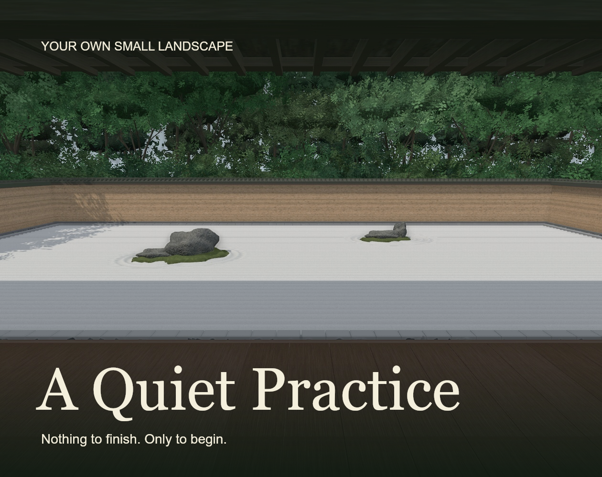

# Ryōan-ji — A quiet practice



A Three.js garden-making experience inspired by Ryōan-ji, Kyoto. The courtyard is an artistic interpretation rather than a measured reconstruction.

The four stone forms (upright, reclining, mountain, split) are freely designed procedural silhouettes, not a historical Japanese stone taxonomy or scans of Ryōan-ji's actual stones. Their material uses continuous three-dimensional mineral grain, fine flecks, veins, pores, and weathered crevices, with an individual seed for every stone.

## Run

```sh
npm install
npm run dev
```

`npm run build` produces the deployable `dist/` directory. WebGL and hardware acceleration are required. Textures, stone geometry, architecture, moss, foliage, and ambient sound are generated locally; Google Fonts is optional and falls back to system fonts.

## Controls

- Hover, tap, or keyboard-focus the small **庭 / TOOLS** sign to unfold the controls. They fold away when you return to the garden.
- **1–5:** Rake, Raise, Press, Push, Smooth. Drag on the gravel.
- **[ / ]:** Decrease / increase brush diameter.
- **6:** Stones. Pick a shape and size, click to place, drag to move.
- **R:** Rotate the selected stone (or the placement preview).
- **Delete / Backspace:** Remove the selected stone.
- **Ctrl / Cmd + Z:** Undo. The last 24 gestures are retained in memory.
- **Right-drag:** Look around. **Scroll:** Zoom. Touch uses one finger to sculpt and two to orbit/zoom.
- **Perspective:** Switch between the seated veranda and elevated view.
- **Contemplate / Escape:** Hide / restore controls.
- **Save:** Store heights, stones, and lighting in this browser's local storage; restored on reload. Saves are browser-local, not cloud-synced.
- **Clear garden:** Remove every stone and flatten the sand. Undo restores the previous scene. **Reset** restores the original composition.

The sculpting ray always intersects the fixed world plane at **y = 0**, including the brush outline. Raised or pressed sand cannot shift the pointer's world position. Veranda orbit angles and zoom are constrained beneath the eaves; the separate elevated perspective has its own orbit limits.

The sand uses a 289 × 139 vertex heightfield with spatial brush falloff. Push transfers equal volume between the leading and trailing brush halves; smoothing averages local neighbors. Stroke interpolation fills gaps during fast dragging. Mesh normals are recomputed after edits. Stones stay attached to the edited surface. The renderer uses ACES tone mapping, ambient occlusion, soft PCF shadows, hemisphere fill, and three light presets.

## Landscape and stone references

- [Nara National Research Institute for Cultural Properties](https://www.nabunken.go.jp/org/bunka/jgd/pages/GardenAtRyoanji_Abbots.html): enclosed white-pebble garden, fifteen stones, five arrangements.
- [Kyoto Travel](https://kyoto.travel/en/destinations/ryoanji-temple/): earthen walls and viewing platform.
- [Smarthistory](https://smarthistory.org/ryoanji-peaceful-dragon-temple/): photographic reference for veranda, raked gravel, moss islands, and irregular stone silhouettes.
- [Japan National Tourism Organization](https://www.japan.travel/en/spot/1145/): landscape context.

Reference images were consulted for visual research; no third-party photos or scanned assets are redistributed in the game.

## Verification

`node --test tests/terrain.test.js` checks brush bounds, raised/pressed heights, push volume conservation, and smoothing. Browser QA covers rendering, tools, undo, saving/reloading, stone manipulation, lighting, and the two viewpoints.
